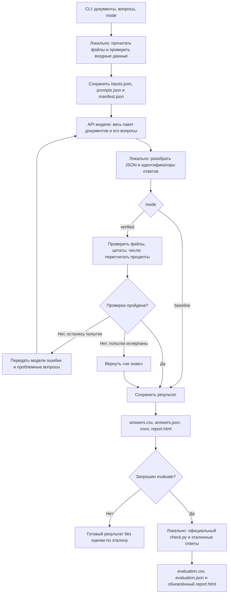

# hacaton-2026 — ответы по документам с доказательствами

Python CLI для кейса ОНСОФТ «ИИ, который не обманывает» на ИТ-ФЕСТ / Школа 21. Программа принимает документы и вопросы, обращается к модели, проверяет доказательства ответов и сохраняет CSV, JSON, журнал и автономный HTML-отчёт. При наличии подходящих эталонов отдельно измеряет качество и сравнивает исходный подход с режимом проверок.

Это инструмент для подготовки и проверки ответов по закупочной документации. Основные пользователи — команда хакатона, разработчики решения и проверяющие, которым нужны воспроизводимые результаты: какой ответ получен, на какой документ он опирается и как его оценил официальный проверщик.

**Минимум для запуска:** Python 3.10+, документы и API-ключ. Основной конвейер использует стандартную библиотеку; для чтения PDF нужен дополнительный `pypdf`. Сервер, база данных, Node.js и веб-приложение не требуются. `report.html` открывается обычным браузером без интернета.

## Содержание

- [Быстрый старт](#section-01)
- [Mode, проверки и оценка качества](#section-02)
- [Конфигурация и зависимости](#section-03)
- [Подготовленный датасет и эталоны](#section-04)
- [Все команды и выбор сценария](#section-05)
- [`query`: произвольные документы и вопросы](#section-06)
- [`run`: таблица вопросов и несколько закупок](#section-07)
- [`ask`: один вопрос к пакету датасета](#section-08)
- [`evaluate`: оценить сохранённые ответы без API](#section-09)
- [`compare`: честное сравнение «было/стало»](#section-10)
- [`report`: пересобрать HTML без генерации и оценки](#section-11)
- [Как устроена программа](#section-12)
- [Чтение документов и ограничения](#section-13)
- [Что сохраняется на выходе](#section-14)
- [Индекс доверия и границы оценки](#section-15)
- [Контекст модели, лимиты и повторы API](#section-16)
- [Логи и безопасность данных](#section-17)
- [Ошибки и диагностика](#section-18)
- [Структура исходного кода и проверка разработки](#section-19)

<a id="section-01"></a>

## Быстрый старт

### Установка и ключ

Для новой копии проекта:

```powershell
git clone --branch procurement-cli https://github.com/Rend-y/hacaton-2026.git
cd hacaton-2026
python --version

# Существующий .env с настроенным ключом сохраняется.
if (-not (Test-Path -LiteralPath .env)) {
  Copy-Item -LiteralPath .env.example -Destination .env
}
```

В `.env` укажите ключ организаторов:

```dotenv
ITFEST_BASE_URL=https://ai.on-soft.ru/v1
ITFEST_MODEL=qwen3-6-practice
ITFEST_API_KEY=ваш_ключ
```

Для уже настроенной локальной папки достаточно открыть терминал в каталоге проекта. Повторно создавать `.env` не нужно. Настоящий ключ не включается в Git: `.env` и его варианты исключены через `.gitignore`.

### Первый небольшой запрос

```powershell
.\run.ps1 query --atacment ".\data\public\packages\P01" --promt "Какой гарантийный срок на результаты работ?" --mode verified
```

Появятся состав документов, этапы API и проверок, ответ с цитатами и путь к `report.html`. Без `--evaluate` это отчёт о работе системы, а не измерение точности.

Тот же запрос с официальной оценкой выбранного вопроса:

```powershell
.\run.ps1 query --atacment ".\data\public\packages\P01" --promt "Какой гарантийный срок на результаты работ?" --mode verified --evaluate
```

Все **71 вопрос** публичного набора, с оценкой после генерации:

```powershell
.\run.ps1 run --mode verified --evaluate
```

`run` связывает каждый вопрос с его закупкой. Полный набор нельзя заменять одним общим `query`: тот рассматривает все переданные документы вместе и создаёт свои ID.

### Способы запуска и относительные пути

| Способ | Пример | Относительно чего считаются пользовательские пути |
|---|---|---|
| Обёртка PowerShell | `.\run.ps1 query ...` | Каталога проекта: скрипт сам переходит в него |
| Python напрямую | `python cli.py query ...` | Текущей рабочей папки терминала |
| Linux/macOS | `python3 cli.py query ...` | Текущей рабочей папки терминала |

На Linux/macOS шаблон окружения можно скопировать через `cp .env.example .env`. Во всех примерах ниже `.\run.ps1` можно заменить на `python cli.py` или `python3 cli.py`; адаптируйте разделители путей под систему. Для внешних документов удобнее указывать абсолютные пути в кавычках.

Обёртка выбирает Python в следующем порядке: переменная окружения `ITFEST_PYTHON`, обычный `python` из `PATH`, затем запасной путь к Python из Codex на исходном компьютере разработки. Этот запасной путь не переносим на другие машины. Укажите свой интерпретатор, если автоматический поиск не подходит:

```powershell
$env:ITFEST_PYTHON = "C:\Python312\python.exe"
.\run.ps1 --help
```

Необязательное виртуальное окружение, если хотите изолировать зависимость для PDF:

```powershell
python -m venv .venv
$env:ITFEST_PYTHON = (Resolve-Path .\.venv\Scripts\python.exe).Path
& $env:ITFEST_PYTHON -m pip install -r requirements-pdf.txt
.\run.ps1 --help
```

Если используете Python напрямую, установите PDF-зависимость именно в него: `python -m pip install -r requirements-pdf.txt`. Для TXT, Markdown, DOCX и поставляемого публичного набора она не нужна.

В многострочных примерах PowerShell обратный апостроф `` ` `` продолжает команду на следующей строке. Он должен быть последним символом строки, без пробелов после него. Любой такой пример можно записать одной строкой.

<a id="section-02"></a>

## Mode, проверки и оценка качества

`--mode` отвечает за **получение ответа**, `--evaluate` — за **оценку уже полученного результата**. Это разные этапы; оба режима используют одну настроенную модель.

| Запуск | Получение ответа | Официальные метрики |
|---|---|---|
| `--mode baseline` | Прямой запрос по документам с форматом JSON | Не считаются |
| `--mode verified` | Расширенные инструкции, локальные проверки, исправления | Не считаются |
| `--mode baseline --evaluate` | Исходный ответ | Считаются по эталону после генерации |
| `--mode verified --evaluate` | Ответ с проверками | Считаются по эталону после генерации |

Флаг `--evaluate` есть у `run` и `query`. У `ask` его нет. Режим по умолчанию — `verified`.

В `baseline` система разбирает формат ответа и сохраняет результат, но не исправляет содержательные ошибки через проверку доказательств. В `verified` проверяются формат, цитаты, числа, даты и поддерживаемый расчёт процентов; неподтверждённый ответ отправляется модели на исправление, а после исчерпания попыток превращается в `не знаю`.

Прохождение этих проверок не означает, что ответ верен по смыслу. Для измерения правильности нужны эталоны. При `query --evaluate` до API проверяется лишь соответствие документов и формулировок вопросов публичному набору; правильные ответы читаются после сохранения ответа модели.

<a id="section-03"></a>

## Конфигурация и зависимости

| Переменная | Значение по умолчанию | Назначение |
|---|---|---|
| `ITFEST_API_KEY` | Нет | Ключ для `run`, `ask`, `query` |
| `ITFEST_BASE_URL` | `https://ai.on-soft.ru/v1` | OpenAI-совместимый HTTPS API; запросы идут на `/chat/completions` |
| `ITFEST_MODEL` | `qwen3-6-practice` | Идентификатор модели |
| `ITFEST_PYTHON` | Автопоиск в `run.ps1` | Путь к интерпретатору для PowerShell-обёртки |

Первые три значения читаются из окружения процесса и локального `.env`; уже заданное окружение имеет приоритет. `.env` не является shell-скриптом, переменные в нём не вычисляются. `ITFEST_PYTHON` нужно задавать в окружении PowerShell: обёртка выбирает интерпретатор до чтения `.env` Python-кодом.

Для `evaluate`, `compare` и `report` ключ и интернет не нужны. Адрес API должен использовать HTTPS и не содержать логин, пароль или query-параметры. Температура генерации фиксирована на `0`; отдельного флага для её изменения нет.

В `requirements-pdf.txt` зафиксирован `pypdf==6.10.0`. PDF поддерживается только через извлечение имеющегося текста; распознавания сканов нет. Ключи хакатона, по сообщению организаторов, действуют до **10 ноября 2026 года, 12:00 МСК**.

<a id="section-04"></a>

## Подготовленный датасет и эталоны

### Датасет для run и ask

```text
my-data/
  questions.csv
  answers_public.json       # нужен только для оценки
  packages/
    P01/
      notice.txt
      contract.txt
    P02/
      notice.txt
```

`questions.csv` для `run` содержит три обязательные колонки:

```csv
id;package;question
P01-01;P01;Какой гарантийный срок на результаты работ?
P02-01;P02;Какой срок выполнения работ?
```

ID должны быть уникальны, поля — непустыми. Имена пакетов допускают латинские буквы, цифры, `_` и `-`; количество пакетов и документов не фиксировано. Каждый вопрос получает документы только из своей папки `packages/<package>`. `run` и `ask` читают `.txt` непосредственно в папке пакета; вложенные папки и другие форматы для этих команд не используются. `ask` получает вопрос из параметра и не читает `questions.csv`.

В `data/public` уже находятся **71 вопрос, 6 пакетов и 26 TXT-документов**:

| Пакет | Вопросов |
|---|---:|
| P01 | 13 |
| P02 | 10 |
| P03 | 10 |
| P04 | 14 |
| P05 | 11 |
| P06 | 13 |

Эталоны `answers_public.json` доступны для публичного набора. На контрольном наборе без эталонов выполняется только генерация; качество оценивает организатор.

### Собственные эталоны для evaluate

`evaluate --data` принимает каталог той же структуры. `answers_public.json` — JSON-массив эталонных записей; формат задаёт неизменённый скрипт `evaluator/check.py`. Пример структуры ниже условный и не является результатом модели:

```json
[
  {
    "id": "P01-01",
    "package": "P01",
    "question": "Какой гарантийный срок на результаты работ?",
    "type": "факт",
    "status": "ответ",
    "kind": "num",
    "expected": [12]
  }
]
```

`id` связывает эталон со строкой ответа; `package` выбирает документы; `type` задаёт группу в метриках; `status` задаёт ожидаемый статус. `kind` и `expected` описывают проверяемое значение:

| `kind` | Проверка значения |
|---|---|
| `num` | Все ожидаемые числа найдены в ответе с допуском менее `0.01` |
| `date` | Ожидаемые дата и время присутствуют в нормализованном ответе |
| `yes` | Есть «да», нет «нет» |
| `no` | Есть ожидаемая формулировка отрицания и нет «да» |
| `all_kw` | Присутствуют все ожидаемые ключевые фрагменты |

Для ожидаемого `нет в документах` проверщик отдельно обрабатывает статус. Поля `source`, `key`, `file`, `quote` присутствуют в публичных эталонах как дополнительные сведения. Для сопоставления `query` важна также согласованность `question` с `questions.csv`. Новый эталон следует готовить и проверять независимо от ответов оцениваемой модели.

<a id="section-05"></a>

## Все команды и выбор сценария

В CLI шесть команд. Общая справка и `--help` каждой команды работают без обращения к модели.

| Команда | Когда использовать | Обращается к модели | Основной результат |
|---|---|---|---|
| `query` | Вопросы к произвольному файлу, нескольким файлам или папкам | Да | Ответы, цитаты, CSV/JSON и HTML; по запросу — оценка известной выборки |
| `run` | Обработать таблицу вопросов, связанную с несколькими закупками | Да | Все ответы набора; по запросу — официальная оценка |
| `ask` | Задать один собственный вопрос к пакету из структуры датасета | Да | Один ответ с доказательствами |
| `evaluate` | Посчитать качество уже сохранённых ответов | Нет | `evaluation.csv`, `evaluation.json`, обновлённый HTML |
| `compare` | Сравнить оценённые `baseline` и `verified` | Нет | Сравнение в JSON, CSV и HTML |
| `report` | Пересобрать HTML по уже существующим результатам | Нет | Обновлённый `report.html` |

```powershell
.\run.ps1 --help
.\run.ps1 query --help
.\run.ps1 run --help
.\run.ps1 ask --help
.\run.ps1 evaluate --help
.\run.ps1 compare --help
.\run.ps1 report --help
```

В примерах ниже используется PowerShell и запуск из папки проекта. Вместо `.\run.ps1` можно писать `python cli.py`, а на Linux/macOS — `python3 cli.py`. Скрипт `run.ps1` устанавливает рабочим каталогом папку проекта; к внешним файлам удобно передавать абсолютные пути. Пути и вопросы с пробелами заключайте в кавычки. В многострочных командах PowerShell обратный апостроф `` ` `` должен быть последним символом строки — без пробелов после него.

<a id="section-06"></a>

## `query`: произвольные документы и вопросы

```text
query --atacment PATH [PATH ...] --promt VALUE [VALUE ...] [--mode baseline|verified] [--evaluate]
```

Написание параметров **`--atacment`** и **`--promt`** является текущим интерфейсом программы. Используйте эти имена точно; `--attachment`, `--prompt`, старые `--content` и `--questions` не являются их заменами.

| Параметр | Обязателен | Значение по умолчанию | Назначение |
|---|---|---|---|
| `--atacment` | Да | — | Один или несколько путей к документам и/или папкам. Папки обходятся рекурсивно |
| `--promt` | Да | — | Один или несколько вопросов в кавычках и/или путей к файлам вопросов |
| `--mode` | Нет | `verified` | `baseline` отвечает напрямую, `verified` включает проверки и исправления |
| `--evaluate` | Нет | Выключен | Оценить выбранные вопросы по публичным эталонам, если документы и вопросы удалось строго сопоставить |
| `-h`, `--help` | Нет | — | Показать справку и завершить работу |

### Один файл, папка или несколько источников

Один вопрос к файлу:

```powershell
.\run.ps1 query --atacment "C:\Docs\Договор.pdf" --promt "Какой гарантийный срок?" --mode verified
```

Один вопрос ко всем поддерживаемым документам в папке:

```powershell
.\run.ps1 query --atacment "C:\Docs\Моя закупка" --promt "Какой срок выполнения работ?"
```

Несколько файлов, папка с приложениями и два вопроса:

```powershell
.\run.ps1 query `
  --atacment "C:\Docs\Договор.docx" "C:\Docs\Изменения.txt" "C:\Docs\Приложения" `
  --promt "Какой срок выполнения работ?" "Какой гарантийный срок на результаты работ?" `
  --mode verified
```

Все выбранные документы образуют **один общий комплект**. Вопросы применяются к нему целиком. Для независимых закупок и их собственных вопросов используйте пакетную команду `run`, которая сохраняет связь `question → package`.

### Несколько вопросов непосредственно в команде

Рабочий пример для пяти вопросов по P01:

```powershell
.\run.ps1 query `
  --atacment ".\data\public\packages\P01" `
  --promt "Какая начальная максимальная цена контракта, в рублях?" `
          "Какой срок выполнения работ?" `
          "Какой гарантийный срок на результаты работ?" `
          "Какой размер обеспечения исполнения контракта, в процентах?" `
          "Какой размер обеспечения заявки, в рублях?" `
  --mode verified --evaluate
```

Каждая строка в кавычках после `--promt` — отдельный вопрос. Если передать весь текст одной строкой в одних кавычках, это будет один вопрос. Пустые вопросы отклоняются. Максимум — 200 вопросов, каждый до 10 000 символов.

### Вопросы из TXT, Markdown, RST, CSV или JSON

```powershell
.\run.ps1 query --atacment "C:\Docs\Моя закупка" --promt "C:\Docs\Вопросы.txt"
```

В TXT/MD/RST каждый непустой ряд становится отдельным вопросом; пустые строки пропускаются:

```text
Какой срок выполнения работ?
Какой гарантийный срок на результаты работ?
```

CSV должен содержать колонку `question` или `вопрос`. Поддерживаются разделители `;` и `,`; выбирается разделитель, которого больше в строке заголовка; при равенстве выбирается `;`. CSV-экранирование позволяет использовать разделители и переносы строк внутри вопроса:

```csv
question
Какой срок выполнения работ?
Какой гарантийный срок на результаты работ?
```

Допустим и файл с дополнительными колонками:

```csv
id;package;question
example-01;P01;Какой срок выполнения работ?
example-02;P01;Какой гарантийный срок на результаты работ?
```

В `query` дополнительные `id` и `package` **не управляют маршрутизацией**. Программа создаёт собственные ID `INPUT-001`, `INPUT-002` и так далее. Для сохранения официальных ID и распределения вопросов по закупкам нужен `run`.

JSON может быть массивом строк:

```json
["Какой срок выполнения работ?", "Какой гарантийный срок на результаты работ?"]
```

Или объектом с полем `questions`:

```json
{
  "questions": [
    {"question": "Какой срок выполнения работ?"},
    {"question": "Какой гарантийный срок на результаты работ?"}
  ]
}
```

Вместо объектов с `question` в массиве также разрешены строки. Название JSON-поля остаётся `questions`, хотя флаг командной строки называется `--promt`.

Можно смешивать текст и файлы вопросов; порядок сохраняется:

```powershell
.\run.ps1 query --atacment "C:\Docs\Моя закупка" --promt "Какая цена контракта?" "C:\Docs\Ещё вопросы.txt"
```

Существующий файл в `--promt` автоматически читается как файл вопросов и исключается из документов, даже если лежит внутри выбранной папки. Каталог вместо файла вопросов отклоняется. Значение, похожее на путь к отсутствующему файлу, выдаёт ошибку до API, а не передаётся модели как вопрос. Это определяется по абсолютному пути, префиксам `./`, `../`, `~/` и их Windows-вариантам либо расширениям TXT/MD/RST/CSV/JSON.

### Оценка выбранной группы через `query --evaluate`

`--evaluate` допустим с обоими режимами:

```powershell
.\run.ps1 query --atacment ".\data\public\packages\P01" --promt "Какой срок выполнения работ?" --mode baseline --evaluate
.\run.ps1 query --atacment ".\data\public\packages\P01" --promt "Какой срок выполнения работ?" --mode verified --evaluate
```

До вызова API проверяются только документы и формулировки вопросов. Весь комплект документов должен по содержимому однозначно совпасть с одной закупкой из `data/public`; переименование файлов допустимо, неполный или изменённый комплект — нет. Проблем чтения быть не должно.

Вопросы сопоставляются с `data/public/questions.csv` по нормализованному тексту: несущественны регистр, `е/ё`, пробелы и пунктуация. Слова, числа и отрицания сохраняются. Дополнительно поддерживаются ровно два сокращения:

| Введённый вопрос | Соответствующий эталонный вопрос |
|---|---|
| `Какой срок выполнения работ?` | `Какой срок выполнения работ, в календарных днях?` |
| `Какой гарантийный срок на результаты работ?` | `Какой гарантийный срок на результаты работ, в месяцах?` |

Неизвестный вопрос, несколько возможных соответствий или два вопроса, ведущие к одному эталону, дают ошибку до обращения к модели. Автоматического смыслового поиска «похожего вопроса» здесь нет.

После генерации официальный оценщик получает **только сопоставленные вопросы**. Для примера с пятью вопросами знаменатель равен пяти, а не 71; в HTML это явно указано. Эталоны правильных ответов не входят в контекст модели. Для произвольных документов без известного эталона запускайте `query` без `--evaluate` — HTML покажет ответы и статистику работы, но не измеренную точность.

### Настройки и результат `query`

Папка результата создаётся автоматически: `runs/ГГГГММДД-ЧЧММСС-микросекунды-query`. CLI печатает точный путь. В ней находятся CSV, подробный JSON, HTML, журналы и снимок входов. Ответы и цитаты также выводятся в терминал.

У `query` нет отдельного интерактивного ввода, `--output`, `--workers`, `--repair-attempts`, `--max-tokens` или `--timeout`. Используются фиксированные значения: один рабочий поток, до двух исправлений в `verified`, лимит ответа 16 384 токена и таймаут одного HTTP-запроса 300 секунд. Для управления этими параметрами подготовьте датасет и используйте `run` либо `ask`.

<a id="section-07"></a>

## `run`: таблица вопросов и несколько закупок

`run` читает `questions.csv`, группирует строки по `package` и передаёт модели документы только соответствующей закупки. ID вопросов сохраняются. Это основной режим для официального набора из **71 вопроса по шести закупкам**.

Все 71 вопрос с оценкой и HTML:

```powershell
.\run.ps1 run --mode verified --evaluate
```

Без немедленной оценки:

```powershell
.\run.ps1 run --mode verified
```

В конкретную новую папку:

```powershell
.\run.ps1 run --mode verified --evaluate --output runs/full-71-v1
```

Одна закупка P01 — 13 исходных вопросов:

```powershell
.\run.ps1 run --packages P01 --mode verified --output runs/p01-v1
```

Несколько закупок:

```powershell
.\run.ps1 run --packages "P01,P04" --mode verified --output runs/p01-p04-v1
```

Список передаётся одним аргументом через запятую, например `--packages "P01,P04"`. В PowerShell кавычки обязательны для списка с запятыми. Неизвестное имя пакета отклоняется. Если фильтр отсутствует, обрабатывается весь файл вопросов.

Другой подготовленный набор:

```powershell
.\run.ps1 run --data "C:\Datasets\control" --mode verified --output runs/control-v1
```

Пример настройки бюджета обработки:

```powershell
.\run.ps1 run --packages P01 --workers 1 --repair-attempts 1 --max-tokens 8192 --timeout 180 --output runs/p01-tuned-v1
```

### Все параметры `run` и общие параметры `ask`

| Параметр | Обязателен | По умолчанию | Допустимые значения и действие |
|---|---|---|---|
| `--data` | Нет | `data/public` внутри каталога проекта | Корень подготовленного датасета |
| `--output` | Нет | `runs/ГГГГММДД-ЧЧММСС-<mode>` | Новая или пустая папка результата; непустая папка запрещена |
| `--mode` | Нет | `verified` | `baseline` или `verified` |
| `--workers` | Нет | `1` | Целое число от 1 до 2; одновременно обрабатываемые закупки |
| `--repair-attempts` | Нет | `2` | Целое число от 0 до 3; дополнительные попытки исправления ответа в `verified`. В `baseline` исправлений нет |
| `--max-tokens` | Нет | `16384` | Целое число от 256 до 32768; максимальный бюджет одного ответа API |
| `--timeout` | Нет | `300` | Положительное число секунд; таймаут одной HTTP-попытки. С повторами обработка может занять дольше |
| `--packages` | Нет | Все пакеты из `questions.csv` | Только у `run`: фильтр вида `P01,P04` |
| `--evaluate` | Нет | Выключен | Только у `run`: после генерации оценить результат и обновить HTML |
| `-h`, `--help` | Нет | — | Показать справку |

`run --packages P01 --evaluate` **не означает индекс только по P01**. Официальный оценщик проходит весь `answers_public.json` выбранного датасета. При стандартном наборе знаменатель остаётся равным 71, а отсутствующие ответы других закупок считаются осторожными. Для оценки небольшой известной группы используйте `query --evaluate` с полным комплектом одной закупки; для итогового эксперимента — полный `run`.

<a id="section-08"></a>

## `ask`: один вопрос к пакету датасета

```text
ask --package PACKAGE --question TEXT [общие параметры run/ask]
```

| Параметр | Обязателен | Назначение |
|---|---|---|
| `--package` | Да | Имя папки закупки внутри `--data/packages`, например `P01` |
| `--question` | Да | Один вопрос в кавычках |

Остальные параметры — `--data`, `--output`, `--mode`, `--workers`, `--repair-attempts`, `--max-tokens`, `--timeout`, `--help` из общей таблицы. У `ask` нет `--packages` и `--evaluate`.

```powershell
.\run.ps1 ask --package P01 --question "Какой гарантийный срок на результаты работ?"
.\run.ps1 ask --data "C:\Datasets\control" --package CONTRACT_01 --question "Какой срок оплаты?" --output runs/custom-payment-v1
```

Для `ask` достаточно папки `packages/<package>`; `questions.csv` не читается. ID создаётся как `<package>-custom`, например `P01-custom`. Такой ID обычно отсутствует в публичных эталонах: оценка полного публичного набора не измерит правильность этого собственного вопроса. Для вопроса, совпадающего с известным публичным эталоном, используйте `query --evaluate`.

<a id="section-09"></a>

## `evaluate`: оценить сохранённые ответы без API

```text
evaluate --run RUN_DIRECTORY [--data DATA_DIRECTORY]
```

| Параметр | Обязателен | По умолчанию | Назначение |
|---|---|---|---|
| `--run` | Да | — | Папка с сохранёнными ответами и метаданными |
| `--data` | Нет | `data/public` в каталоге проекта | Эталонный набор: `answers_public.json` и `packages` |
| `-h`, `--help` | Нет | — | Показать справку |

```powershell
.\run.ps1 evaluate --run runs/full-71-v1
.\run.ps1 evaluate --run runs/control-v1 --data "C:\Datasets\control"
.\run.ps1 evaluate --run "runs/ИМЯ-СОХРАНЁННОГО-QUERY"
```

Повторных запросов к модели нет. Команда создаёт или обновляет `evaluation.csv`, `evaluation.json` и `report.html`.

Для обычного `run` оценивается весь переданный эталон, включая пропущенные вопросы. Для сохранённого `query` программа распознаёт `INPUT-*`, сверяет снимок документов и вопросов, повторяет строгое сопоставление и оценивает только выбранную группу. Старый `query`, запущенный без `--evaluate`, можно оценить этой командой позже, если его входы соответствуют известному эталону.

Оценка привязана к SHA-256 итогового `answers.csv`. После изменения CSV прежняя оценка не считается актуальной; выполните `evaluate` снова. У `query` дополнительно проверяется, что исходный снимок и список вопросов не были изменены после генерации.

<a id="section-10"></a>

## `compare`: честное сравнение «было/стало»

```text
compare --baseline BASELINE_RUN --verified VERIFIED_RUN --output COMPARISON_DIRECTORY
```

Все три параметра обязательны. `--baseline` указывает запуск в режиме `baseline`, `--verified` — запуск в режиме `verified`, `--output` — папку для файлов сравнения. Дополнительно доступен `--help`.

Полный воспроизводимый эксперимент на 71 вопросе:

```powershell
.\run.ps1 run --mode baseline --evaluate --output runs/baseline-v1
.\run.ps1 run --mode verified --evaluate --output runs/verified-v1
.\run.ps1 compare --baseline runs/baseline-v1 --verified runs/verified-v1 --output comparison/v1
```

Запускайте команды последовательно. Для повторного эксперимента выберите новые имена папок, например `baseline-v2` и `verified-v2`.

Если генерация уже выполнена без оценки, сначала отдельно оцените обе версии:

```powershell
.\run.ps1 evaluate --run runs/baseline-v1
.\run.ps1 evaluate --run runs/verified-v1
.\run.ps1 compare --baseline runs/baseline-v1 --verified runs/verified-v1 --output comparison/v1
```

Сравнивать можно и два оценённых запуска `query` с одинаковым набором документов и вопросов — подставьте их автоматически созданные папки вместо `runs/baseline-v1` и `runs/verified-v1`.

Для корректного сравнения должны совпадать:

- модель и адрес API;
- документы, тексты вопросов и их ID;
- температура и лимит ответа;
- эталонный набор, версия оценщика и область оценки;
- общее число оценённых вопросов и их распределение по типам.

Оба современных запуска должны завершиться со статусом `completed`, а их оценки — соответствовать текущим ответам. Технически не завершённые запуски и запуски с ошибками API отклоняются. Эти проверки отделяют эффект метода от смены входов или сбоя сервиса.

Создаются `comparison.json`, `comparison.csv` и `report.html`: общие показатели, разница индекса, разбивка по типам и доступная статистика затрат. Если такая папка сравнения уже существует, файлы сравнения обновляются; исходные папки ответов не изменяются.

<a id="section-11"></a>

## `report`: пересобрать HTML без генерации и оценки

Укажите ровно один источник:

```powershell
.\run.ps1 report --run runs/verified-v1
.\run.ps1 report --comparison comparison/v1
```

| Параметр | Обязателен | Назначение |
|---|---|---|
| `--run` | Один из двух | Папка одного запуска |
| `--comparison` | Один из двух | Папка с `comparison.json` и доступными исходными запусками |
| `-h`, `--help` | Нет | Показать справку |

Команда только читает сохранённые данные, проверяет их согласованность и заменяет `report.html`. Она не обращается к модели и не запускает оценщик. Если `evaluation.json` отсутствует, индекс не появляется: сначала выполните `evaluate` при наличии подходящего эталона.

При пересборке сравнения повторно проверяются исходные запуски и метрики. Если они изменились, сначала повторите `evaluate` при необходимости, затем `compare`. Уже сформированный HTML можно просматривать отдельно, но для повторной генерации нужны исходные файлы.

<a id="section-12"></a>

## Как устроена программа

CLI отвечает на вопросы по загруженным документам, сохраняет ответ вместе с цитатами и умеет отдельно оценивать результат официальным проверяющим скриптом хакатона. Генерация обращается к внешней модели; чтение файлов, проверка цитат, арифметика, сохранение результатов, оценивание и построение HTML выполняются локально.

В текущей реализации весь доступный текст одного пакета передаётся модели вместе с его вопросами. Индекса, векторной базы, поиска RAG и автоматического отбора фрагментов нет. Для `query` все переданные файлы и директории образуют один корпус `INPUT`; программа не разделяет вложенные папки на разные закупки. В режиме `run` отдельным корпусом служит каждый пакет `P01`, `P02` и так далее.



Для `query --evaluate` перед первым запросом к модели дополнительно проверяется, что документы и вопросы однозначно соответствуют публичному набору. На этом предварительном шаге эталонные ответы не читаются. Само сравнение с эталоном происходит после генерации.

Локальная проверка ответа выполняется во время обычного запуска программы. Это не CI и не запуск тестов проекта. Тесты разработчика запускаются отдельно командой `python -m unittest discover -s tests -v`.

### Что проверяет `verified`

1. Ответ имеет допустимый статус и ожидаемый идентификатор вопроса.
2. Для содержательного ответа приведены непустой текст и доказательства.
3. Указанный файл действительно есть среди прочитанных документов этого пакета.
4. Цитата после нормализации встречается в указанном файле; слишком короткие цитаты отклоняются.
5. Числа, даты и время из ответа подтверждаются цитатами. Для поддерживаемого расчёта отдельно проверяются операнды и результат.
6. Для статуса `расхождение` приведены доказательства минимум из двух разных файлов.
7. Статус `нет в документах` запрещается, если чтение корпуса было неполным или не удалось получить ни одного текстового документа.

Цитата должна иметь не менее восьми символов после нормализации. Проверка ищет текстовое совпадение, а не оценивает смысл цитаты независимой моделью. Проверка чисел учитывает особый вид дат и времени и исключает некоторые номера пунктов.

Поддерживаемая арифметическая операция — процент от базы: `base × rate / 100`. Она пересчитывается локально через `Decimal` с округлением до двух знаков `ROUND_HALF_UP`. База и ставка должны быть подтверждены указанными доказательствами. Произвольный код или выражения от модели не исполняются; универсального калькулятора формул нет. Расчёт не должен превращать найденное расхождение в единственное выбранное значение.

При ошибке модели отправляются замечания локальной проверки, предыдущий ответ и только вопросы, которые ещё требуют исправления. Документы пакета остаются в контексте. По умолчанию допускаются два исправления после первоначального ответа. Уже принятые ответы повторно не генерируются. Если подтверждение получить не удалось, результатом становится `не знаю`.

Промпт просит модель учитывать изменения документов, различать отсутствие сведений и явное отрицание, сохранять единицы измерения и показывать противоречия. Однако формального механизма версий договоров и независимого смыслового критика в программе нет. Проверка наличия цитаты не доказывает её относимость к вопросу, правильность интерпретации условия или полноту поиска отсутствующего факта.

<a id="section-13"></a>

## Чтение документов и ограничения

### Форматы документов для `query`

| Формат | Что извлекается | Ограничения |
|---|---|---|
| `.txt`, `.md`, `.rst`, `.csv`, `.json` | Текст файла | CSV/JSON, переданные как документы, читаются как текст, без отдельной предметной интерпретации |
| `.html`, `.htm` | Текст HTML | Содержимое `script`, `style`, `noscript` исключается; сценарии не исполняются, внешние ресурсы не загружаются |
| `.docx` | Текст абзацев, таблиц, колонтитулов, сносок и концевых сносок | Изображения и вложения не распознаются; сведения о непрочитанном содержимом сохраняются как предупреждения |
| `.pdf` | Текстовый слой страниц | Нужен `pypdf` из `requirements-pdf.txt`; OCR нет, сканы и пустые страницы могут остаться непрочитанными |

Основная программа использует стандартную библиотеку Python 3.10+. Для PDF предусмотрена отдельная зависимость `pypdf==6.10.0`; её установка не добавляет OCR. Форматы `.doc`, `.xlsx`, изображения и произвольные архивы не конвертируются автоматически.

Текстовые файлы поддерживают UTF-8, UTF-8 с BOM и CP1251. UTF-16 принимается при наличии BOM. Двоичные управляющие символы и UTF-16 без BOM отклоняются. Разрывы строк приводятся к единому виду.

Директории обходятся рекурсивно. Одинаковые физические файлы не добавляются повторно; совпадающим отображаемым именам назначаются суффиксы. Исходные пути и форматы сохраняются в `inputs.json`. Пропускаются скрытые объекты с именем, начинающимся с точки, технические каталоги (`__pycache__`, `node_modules`, `venv`, `.venv`), файлы вопросов и известные результаты программы. Символические ссылки и Windows junction не обходятся и отмечаются как неполнота чтения.

`answers_public.json`, `answers.csv`, `answers.json`, `evaluation.*`, `manifest.json`, `inputs.json`, `prompts.json`, `trace.jsonl`, `progress.log`, `report.html`, `comparison.*` и `questions.csv` считаются служебными именами. Такие файлы не используются как документы для ответов. Если явно передать служебный файл через `--atacment`, программа сообщит об ошибке. Это защищает от случайного включения эталонов и предыдущих ответов в новый контекст.

Если часть файлов не прочитана, пригодные документы сохраняются, а ошибки попадут в снимок входных данных и диагностику. В `verified` при таком корпусе нельзя утверждать `нет в документах`; положительный ответ с проверяемыми доказательствами остаётся возможным. Если не прочитан ни один документ, `query` завершится до обращения к модели.

### Ограничения загрузчика `query`

| Параметр | Предел |
|---|---:|
| Документы | 500 файлов |
| Размер одного файла | 20 МиБ |
| Суммарный размер рассматриваемых файлов | 80 МиБ |
| Извлечённый текст одного файла | 2 000 000 символов |
| Объекты при обходе каталогов | 5 000 |
| Страницы одного PDF | 300 |
| Поток содержимого страницы PDF | 8 МиБ |
| Элементы архива DOCX | 5 000 |
| Суммарный распакованный размер DOCX | 80 МиБ |
| Одна текстовая XML-часть DOCX | 20 МиБ |
| Вопросы в одном `query` | 200 |
| Длина одного вопроса | 10 000 символов |

Это ограничения чтения файлов. Отдельно действует более строгая проверка размера контекста перед API-запросом. Поэтому успешная загрузка большого корпуса не означает, что он поместится в запрос модели.

<a id="section-14"></a>

## Что сохраняется на выходе

Каждый запуск генерации создаёт отдельную папку внутри `runs/`, если у команды не задан другой доступный путь вывода. Для `query` имя содержит время с микросекундами и суффикс `query`. Существующий непустой каталог вывода использовать нельзя: предыдущий результат не перезаписывается.

| Файл | Назначение |
|---|---|
| `answers.csv` | Основной результат в формате для официального оценщика: `id;status;answer;quote;file` |
| `answers.json` | Подробные ответы: все доказательства, пояснение, данные расчёта и техническая ошибка, если она была |
| `inputs.json` | Снимок вопросов, извлечённых документов и ошибок чтения; у `query` также сведения об исходных файлах |
| `prompts.json` | Тексты системных инструкций для режимов, позволяющие проверить условия запуска |
| `manifest.json` | Режим, модель, параметры, отпечаток входных данных, состояние запуска, время и статистика API |
| `progress.log` | Читаемый журнал этапов и ожидания, дублирующий сообщения прогресса терминала |
| `trace.jsonl` | Подробный технический журнал запросов, ответов, проверок и попыток исправления |
| `report.html` | Локальный HTML с ответами, цитатами, диагностикой и доступными метриками |
| `evaluation.csv` | После оценки: строки `id;type;verdict;why` от официального оценщика |
| `evaluation.json` | После оценки: общие показатели, показатели по типам вопросов, область оценки и контрольные отпечатки |

В CSV разделитель — точка с запятой, кодировка — UTF-8. В полях `answer` и `quote` переводы строк и повторные пробелы сворачиваются. В CSV помещается только первое доказательство ответа; полный список цитат остаётся в JSON. У статусов `не знаю` и `нет в документах` поля `answer`, `quote`, `file` в CSV пустые — это часть принятого формата, а не потеря текста при сохранении.

Ответы и статистика сохраняются после завершения каждого пакета. `manifest.json` получает состояние `completed` либо `completed_with_errors`. Во втором случае хотя бы один ответ содержит технический `error_type`: например, `api`, `input_read`, `model_format` или `internal`. Обычный отказ `не знаю` после недостаточного подтверждения сам по себе не считается технической ошибкой.

Команда `compare` создаёт в своей папке `comparison.json`, `comparison.csv` и `report.html`. CSV сравнения содержит `scope`, `type`, `metric`, `baseline`, `verified`, `delta`.

### Что показывает HTML

Отчёт оформлен в строгом светлом стиле: крупные показатели, компактные таблицы, поиск и фильтры, раскрывающиеся цитаты. Он адаптируется к узкому экрану и использует системные шрифты без загрузки ресурсов из интернета. Кнопка «Печать / PDF» открывает стандартную печать браузера. Правила оформления и доступности описаны в [дизайн-системе отчёта](design-system/it-fest-report/MASTER.md).

`report.html` можно открыть обычным браузером прямо с диска. Встроенные CSS и JavaScript не требуют веб-сервера или CDN. В отчёте есть поиск и фильтры ответов, раскрытие доказательств, параметры запуска, время и использование API. После оценки добавляются индекс доверия, количество верных, осторожных и ошибочных ответов, а также разбивка по типам вопросов. Отчёт можно распечатать в PDF средствами браузера.

Ссылки для открытия соседних CSV/JSON требуют сохранения этих файлов рядом с HTML. Для передачи полного проверяемого результата удобнее передавать всю папку запуска. Без `evaluate` отчёт показывает работу системы и её ответы, но не выдумывает оценку правильности или индекс доверия.

### Статус ответа и вердикт оценщика

| Поле | Значения | Кто формирует |
|---|---|---|
| `status` | `ответ`, `расхождение`, `нет в документах`, `не знаю` | Генерация и локальная обработка |
| `verdict` | `верно`, `осторожно`, `обман` | Официальный оценщик по эталону |

Например, статус `ответ` означает, что система дала содержательный ответ. Он может получить вердикт `верно` или `обман` в зависимости от результата проверки по эталону. Слово `обман` здесь обозначает категорию официального оценщика, а не установленное намерение модели.

<a id="section-15"></a>

## Индекс доверия и границы оценки

Оценка выполняется неизменённым `evaluator/check.py` из набора организаторов. Модуль `evaluation.py` запускает его отдельным процессом, проверяет согласованность результатов и сохраняет машинный итог. Эталон `answers_public.json` используется на этапе оценки и не передаётся генератору.

```text
Индекс доверия = round((верно − обман) / N × 100, 1)
N = верно + осторожно + обман
```

Каждый верный ответ даёт `+1`, ошибочный — `−1`, осторожный — `0`; затем сумма делится на размер оцениваемого набора. Индекс находится от `−100` до `100`. Если все ответы осторожные, индекс равен `0`. При пустом наборе также используется `0`. Это показатель набора ответов, а не вероятность истинности конкретного ответа и не самооценка модели.

Условный пример арифметики: из 10 вопросов 7 верных, 1 ошибочный и 2 осторожных дают `(7 − 1) / 10 × 100 = 60`. Это пример формулы, а не результат измерения проекта.

### Почему знаменатель бывает разным

| Сценарий | Какие вопросы входят в оценку | Знаменатель |
|---|---|---|
| `run --evaluate` или `evaluate` обычного запуска | Весь переданный эталонный набор | Все строки эталона; для текущего публичного набора — 71 |
| `run --packages P01 --evaluate` | Всё равно весь эталон; отсутствующие ответы учитываются оценщиком как осторожные | Для стандартных публичных данных — 71 |
| `query --evaluate` или `evaluate` сохранённого `query` | Только строго сопоставленные заданные вопросы | Размер выбранной группы, например 5 |

Для `query --evaluate` документы должны полностью соответствовать ровно одному пакету публичного набора по содержимому извлечённых текстов, без ошибок чтения. Все вопросы должны однозначно сопоставляться с его публичными вопросами. Используется точное сопоставление после нормализации, а не смысловой поиск моделью. Повторное сопоставление одного эталонного вопроса, неизвестные или неоднозначные вопросы отклоняются до генерации.

Дополнительно предусмотрены две короткие формулировки для соответствующих вопросов публичного набора:

- `Какой срок выполнения работ?` → вопрос со словами `в календарных днях`;
- `Какой гарантийный срок на результаты работ?` → вопрос со словами `в месяцах`.

После генерации выбираются подходящие эталоны, а их идентификаторы временно сопоставляются с `INPUT-…`. Официальный оценщик остаётся неизменённым; исходные `answers.csv` и `answers.json` не переписываются. Оценка такой выборки помечается `scope=matched_query_questions`. Её нельзя выдавать за оценку всех 71 вопросов.

Для произвольных документов и авторских вопросов официальная оценка недоступна, если для них нет соответствующего эталонного набора. Генерация и локальные проверки при этом работают обычным образом.

### Воспроизводимость и сравнение

`inputs.json` и SHA-256-отпечаток связывают запуск с конкретными вопросами, документами и ошибками чтения. Для оценки сохраняются отпечатки CSV ответов, документов, эталонов и кода оценщика. Сводные счётчики сверяются с построчным `evaluation.csv`; изменение ответов после оценки обнаруживается при последующей проверке отчёта.

`compare` проверяет одинаковые модель, адрес API, входные данные, набор идентификаторов, параметры температуры и длины ответа при их наличии, область оценки и размер набора. Технически незавершённые или завершённые с ошибками современные запуски для сравнения отклоняются. Разные корпуса или разные выборки нельзя честно сравнивать как улучшение одного режима над другим.

Для демонстрации улучшения следует выполнить оба режима на одинаковых данных, оценить оба результата и только затем построить сравнение. Наличие команды `compare` само по себе не означает, что полное сравнение уже проведено или что рост индекса измерен.

### Статистика выполнения не является качеством ответов

| Поле статистики | Значение |
|---|---|
| `requests` | Количество HTTP-попыток, включая неудачные запросы и сетевые повторы |
| `successful_requests` | Количество разобранных ответов API; не количество верных ответов на вопросы |
| `http_retries` | Повторы из-за временных HTTP/сетевых сбоев |
| `prompt_tokens`, `completion_tokens` | Использование токенов, сообщённое провайдером в `usage` |
| `elapsed_seconds` | Время этапа генерации, включая ожидание и повторы; без последующего оценивания и построения HTML |
| Попытки исправления в отчёте | Итерации исправления ответа после локальной проверки; отличаются от сетевых повторов |

Если провайдер не вернул `usage`, соответствующий расход не восстанавливается из текста. `successful_requests` может включать ответ с обрезанным или непригодным содержимым: API ответил, но задачу это ещё не решает. Денежная стоимость по этим полям автоматически не рассчитывается.

<a id="section-16"></a>

## Контекст модели, лимиты и повторы API

Адрес API должен использовать HTTPS и не содержать встроенные логин/пароль, query-параметры или фрагмент. HTTP-перенаправления не используются, чтобы не отправлять ключ другому адресу.

Параметры генерации по умолчанию: `temperature=0`, `max_tokens=16384`, таймаут одного HTTP-запроса `300` секунд, один рабочий поток, два исправления в `verified`. Для команд с соответствующими настройками допустимы `max_tokens` от `256` до `32768`, рабочие потоки от `1` до `2`, исправления от `0` до `3`; таймаут должен быть положительным. У упрощённого `query` отдельных флагов настройки этих величин нет.

Перед отправкой применяется консервативная проверка контекста: сумма размеров сообщений в байтах UTF-8, небольшой запас на каждое сообщение и `max_tokens` должны укладываться в `128000`. Это намеренно грубая оценка без токенизатора, поэтому отказ возможен раньше фактического заполнения окна модели. Большой корпус нужно разделить на осмысленные меньшие наборы; программа не выполняет это автоматически.

Один клиент ограничивает нагрузку до двух параллельных запросов, 40 HTTP-запросов и 600 000 оценочных токенов в скользящем окне 61 секунды. Лимит действует только внутри текущего процесса. Несколько терминалов или участники команды с общим ключом не координируются. Суточный бюджет ключа программа глобально не отслеживает.

Временные ошибки `408`, `429`, `500`, `502`, `503`, `504` и сетевые сбои повторяются до трёх HTTP-попыток на одно обращение к модели. Обычные задержки перед повторами — 2 и 4 секунды. Для `429` паузы составляют как минимум 30 и 60 секунд; числовой `Retry-After` также учитывается в пределах 120 секунд. Ошибки авторизации автоматически не исправляются повтором.

Во время ожидания ответа примерно каждые 10 секунд появляется сообщение с прошедшим временем. Это признак продолжающегося ожидания, а не процент готовности модели. Из-за повторов и ограничителя нагрузки суммарное ожидание может значительно превышать таймаут одного запроса.

<a id="section-17"></a>

## Логи и безопасность данных

`progress.log` помогает понять текущий этап: чтение документов, подготовка запроса, ожидание API, проверка ответа, исправление и сохранение. `trace.jsonl` предназначен для разбора конкретного сбоя: записи содержат события запросов и проверок. Транспортные повторы и исправления ответа — отдельные механизмы, их следует различать при диагностике.

В журнале маскируется настроенный API-ключ и удаляются управляющие символы терминала. Поле провайдера `reasoning_content` не сохраняется; из содержимого ответа убираются блоки `<think>…</think>`. При этом обычные ответы, цитаты, документы и пути могут присутствовать в артефактах. Папку запуска следует считать копией загруженных данных и передавать с учётом их содержимого.

`.env`, `.venv`, кэши Python, `runs/` и `comparison/` исключены из Git через `.gitignore`. Генерация отправляет извлечённый корпус внешнему серверу модели. Чтение файлов, оценивание и просмотр готового HTML выполняются локально.

<a id="section-18"></a>

## Ошибки и диагностика

| Симптом | Что означает | Что сделать |
|---|---|---|
| `Set ITFEST_API_KEY...` | Не задан ключ генерации | Указать `ITFEST_API_KEY` в локальном `.env` или окружении |
| HTTP `401`/`403` | Сервер не разрешил обращение | Проверить ключ, доступ и адрес API; не публиковать ключ в логах и скриншотах |
| HTTP `429` | Сервер ограничил нагрузку или доступный бюджет | Дождаться встроенных повторов, остановить параллельные запуски с тем же ключом и повторить позже; одна группа вопросов тоже может получить `429` |
| Сетевой таймаут | Сервер не ответил в пределах одной попытки или сеть недоступна | Посмотреть `progress.log`, проверить доступность сервиса; для команд с `--timeout` при необходимости увеличить таймаут |
| `context guard` / пакет слишком большой | Консервативная оценка контекста превышена | Уменьшить набор документов и/или вопросов; лимит загрузчика файлов и контекст модели — разные ограничения |
| `Model response truncated` | Ответ достиг `max_tokens` | Уменьшить группу вопросов; для команд с `--max-tokens` увеличить допустимый предел, учитывая общий контекст |
| PDF не читается | Нет `pypdf`, повреждён файл, защита или отсутствует текстовый слой | Установить `requirements-pdf.txt`; скан предварительно распознать отдельным OCR-инструментом |
| Есть предупреждения о непрочитанных документах | Корпус неполный | Проверить перечисленные файлы, кодировку и формат; не считать `нет в документах` доказанным отсутствием |
| `unrecognized arguments` | У команды нет такого аргумента или используется другая версия проекта | Проверить `python cli.py <команда> --help`; использовать точные имена `--atacment`, `--promt` |
| Каталог вывода непустой | Защита от перезаписи предыдущего запуска | Выбрать новый путь вывода либо оставить автоматическое имя |
| `query --evaluate` не сопоставляет данные | Документы/вопросы не соответствуют одному публичному пакету | Передать полный соответствующий пакет и точные вопросы; для произвольного корпуса выполнить `query` без оценки |
| Оценка не совпадает с ответами / изменился отпечаток | Файлы изменились после оценки либо смешаны разные результаты | Восстановить согласованную папку или повторно выполнить `evaluate` по нужному набору |
| `compare` отклоняет запуск | Входы/настройки/область оценки различаются либо есть технический сбой | Сравнивать два завершённых и оценённых запуска на одних входных данных |

По одному сообщению `429` нельзя установить, исчерпаны ли RPM, токены, параллельные слоты или серверная ёмкость: тело HTTP-ошибки в текущей диагностике не раскрывается. Токены и запросы других участников команды также не видны этому процессу.

### Коды завершения

| Код | Значение |
|---:|---|
| `0` | Команда завершилась без обнаруженной технической ошибки; это не гарантия правильности всех ответов |
| `1` | Обработанная ошибка данных, конфигурации, файлов или оценки с сообщением `ERROR:` |
| `2` | Генерация завершилась с техническими ошибками в ответах; также код `2` использует `argparse` при ошибке синтаксиса команды |

Проверять нужно не только код, но и сообщение, `manifest.json` и отчёт. Низкий индекс доверия сам по себе не делает успешную команду технически ошибочной.

`Ctrl+C` не имеет отдельного механизма корректного продолжения: могут остаться частичные результаты и `status=running`. Встроенного `resume` нет. После прерывания дождитесь завершения процесса и запустите задачу заново в новой папке. Не следует считать частичный запуск завершённым экспериментом.

<a id="section-19"></a>

## Структура исходного кода и проверка разработки

| Файл | За что отвечает |
|---|---|
| `cli.py` | Команды, пакетная обработка, цикл исправлений и сохранение запуска |
| `client.py` | Настройки API, HTTPS-запросы, ограничение нагрузки и сетевые повторы |
| `progress.py` | Журнал прогресса, ожидание и безопасный вывод |
| `prompts.py` | Инструкции модели для двух режимов |
| `validation.py` | Проверка доказательств и локальный расчёт процентов |
| `input_loader.py` | Чтение произвольных документов и файлов вопросов |
| `query.py` | Подготовка упрощённого ввода `--atacment`/`--promt` |
| `query_evaluation.py` | Сопоставление `query` с публичным пакетом и оценка выборки |
| `evaluation.py` | Запуск официального оценщика, проверка метрик и сравнение запусков |
| `evaluator/check.py` | Официальные правила оценивания организаторов |
| `report.py`, `report_view.py` | Подготовка данных и оформление HTML-отчёта |
| `tests/` | Автоматические проверки CLI, загрузчиков, клиента, валидации, оценки и отчётов |
| `run.ps1` | Запуск Python CLI из PowerShell |

```powershell
python -m unittest discover -s tests -v
```

При проверке версии с оценкой `query` успешно пройден 151 тест. Тесты используют подменённый API-клиент и локальный официальный оценщик; обращения к реальной модели и ключ не требуются. PDF-зависимые проверки могут пропускаться, если необязательный `pypdf` не установлен. Успешные тесты подтверждают проверенные свойства реализации, но не заменяют измерение качества реальных ответов на хакатонном наборе.
